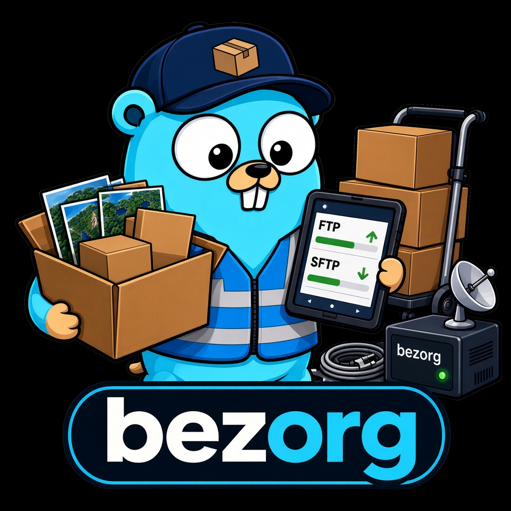

# bezorg

`bezorg` is a single-binary Go client for unattended FTP, FTPS, and SFTP downloads. It is built for drops that contain tens of thousands of small files mixed with a smaller number of very large files: every transfer is streamed, partial files resume, and a background daemon keeps the job running after you log out.

The layout matches that split:

- `bezorg` is the client. `bezorg run` downloads in the foreground. `bezorg fetch` hands the job to the daemon and returns immediately.
- `bezorgd` is the daemon. It listens on a private Unix socket, persists job state, and resumes interrupted downloads when it starts. `--web-listen` serves a small dashboard and `--metrics-listen` serves Prometheus metrics from the same binary.

## Install

Release archives cover Linux on AMD64 and ARM64. The installer verifies `checksums.txt` from the GitHub release, then places `bezorg` and `bezorgd` in `~/.local/bin` (`BEZORG_INSTALL_DIR` overrides that). `BEZORG_VERSION` pins a tag.

```sh
curl -fsSL https://raw.githubusercontent.com/GerhardOfRivia/bezorg/refs/heads/main/install.sh | sh
```

## Build

The module requires Go 1.27. The build is pure Go and produces static binaries.

```sh
make build
# bin/bezorg and bin/bezorgd
./bin/bezorg version
./bin/bezorgd version
```

Install both onto the host that should receive the delivery:

```sh
sudo install -m 0755 bin/bezorg bin/bezorgd /usr/local/bin/
```

`make test` runs the unit tests, including an in-process FTP server (resume, REST, NOOP, checksums) and an in-process SFTP server.

## Foreground: a small test delivery

`examples/small.yaml` is a lab-sized FTP drop. `${BEZORG_PASSWORD}` is read from the environment when the file is loaded.

```sh
export BEZORG_PASSWORD='secret'
bezorg run --config examples/small.yaml
```

The same settings can be passed as flags:

```sh
bezorg run \
  --protocol ftp \
  --host ftp.example.com --port 21 \
  --user delivery --password "$BEZORG_PASSWORD" \
  --remote /incoming/sample \
  --local /data/sample \
  --concurrency 2 \
  --checksum auto
```

`--dry-run` lists the remote tree and does not write. A run is safe to repeat: files whose local size already matches are skipped, and a `*.bezorg-partial` file is resumed instead of fetched from byte zero.

Cron can call `bezorg run` directly. The process stays in the foreground and its exit code is the result of the delivery.

## Background: a multi-thousand-file imagery drop

`examples/imagery.yaml` is the shape of a real drop: explicit FTPS, six connections, at most two of them used for large rasters, keepalive on the control connection, and several job-level retries if the server disappears for a few minutes.

Start the daemon (or the systemd unit below), then queue the job:

```sh
sudo systemctl enable --now bezorgd
export BEZORG_PASSWORD='secret'
bezorg fetch --config /etc/bezorg/imagery.yaml
# prints a job id, for example 4f2a91c0b7e3

bezorg status 4f2a91c0b7e3
bezorg logs --follow 4f2a91c0b7e3
bezorg wait 4f2a91c0b7e3
```

`fetch` returns as soon as the daemon has queued the job. The download continues if the shell exits. `wait` is the cron-friendly form: it blocks and exits with the job's status. `cancel` stops a job. `retry` queues a failed, canceled, or interrupted job again; files that already match are not downloaded a second time.

SFTP uses the same commands. Set `protocol: sftp`, port 22, and either a password or a key:

```yaml
protocol: sftp
host: sftp.example.com
port: 22
user: imagery
private_key: ~/.ssh/id_ed25519
known_hosts: ~/.ssh/known_hosts
remote: /outgoing/2026-11-17
local: /data/imagery/2026-11-17
```

`protocol: auto` reads the service banner. An `SSH-` banner selects SFTP and a `220` banner selects plain FTP. Explicit and implicit FTPS are not guessed; set `ftps` or `ftps-implicit`.

## What the daemon stores

Job records live under the state directory (`BEZORG_STATE_DIR`, or `~/.local/state/bezorg`). Each job is a directory:

- `job.json` holds the settings, including the password, mode `0600`
- `log` is the job log

The control socket (`BEZORG_SOCKET`, or `$XDG_RUNTIME_DIR/bezorg/bezorg.sock`) is mode `0600`. API responses redact the password. On startup the daemon re-queues jobs that were `queued`, `running`, or `interrupted`.

## How a transfer works

Listing uses MLSD when the server advertises it, with LIST as a fallback. FTP is always binary. Each worker keeps its own connection and reuses it across files.

- **Resume.** FTP sends `REST` plus `RETR`. SFTP seeks to the local partial length. The partial name is the destination plus `.bezorg-partial`.
- **Atomic completion.** The partial file is synced, the size is checked, and an optional checksum is checked. Only then is it renamed onto the final path.
- **Mixed files.** Files at or above `large_min_bytes` (default 64 MiB), files of at least 8 MiB, use a separate lane. `large_concurrency` caps that lane (default 2 when concurrency is higher). The other workers stay on the small-file lane, so one multi-gigabyte raster cannot occupy every connection.
- **Keepalive.** During a long FTP transfer the control connection sends `NOOP`. SSH sends `keepalive@openssh.com`. TCP keepalive is enabled on both. A server that rejects a mid-transfer `NOOP` is disconnected and the next file dials again; the bytes already on disk are kept.
- **Retries.** Timeouts, resets, short reads, `421`, `425`, and `426` retry with exponential backoff and a new connection. `421` also pulls one connection slot out of circulation for 30 seconds. Authentication failures and missing files do not retry. `job_retries` runs the whole job again after a transient failure; completed files are skipped.
- **Checksums.** FTP uses `HASH` (then `XSHA256`, `XSHA1`, `XMD5`, or `MD5`) when the server advertises it. Otherwise a sidecar named `<file>.sha256`, `<file>.sha1`, or `<file>.md5` is read. `checksum: require` fails a file when neither is available. SFTP has no standard hash command, so only sidecars are used. Checksums are streamed from disk after the download, not held in memory.
- **Passive FTP.** Data connections are passive. EPSV is tried first and then PASV. The PASV address is replaced with the control host unless `trust_pasv_ip` is set. `--disable-epsv` and `--force-ipv4` cover the usual broken servers.
- **Bandwidth.** `--bandwidth 20M` (or `bandwidth:` as a byte count in YAML) is a global token bucket shared by every worker in the job.

A remote directory is mirrored into the local directory. A remote file is saved inside the local directory when that path is an existing directory or ends in `/`; otherwise the local path is the output file. Symlinks are skipped and logged. Directory structure is created as files arrive.

## Configuration

YAML keys match the flags (`large-concurrency` on the command line, `large_concurrency` in the file). Flags win. Durations are strings such as `30s` and `2m`.

| Setting | Default | Meaning |
| --- | --- | --- |
| `protocol` | `auto` | `auto`, `ftp`, `ftps`, `ftps-implicit`, `sftp` |
| `concurrency` | `6` | Connections per job. Hard cap 64. |
| `large_concurrency` | `2` | Large-file streams. `0` picks the default. |
| `large_min_bytes` | 64 MiB | Size that enters the large lane. |
| `connect_timeout` | `30s` | Dial and login. |
| `stall_timeout` | `2m` | No bytes received. The transfer is aborted and resumed. |
| `keepalive` | `45s` | Control-connection keepalive. `0s` disables it. |
| `keepalive_min_bytes` | 32 MiB | Smallest file that sends FTP `NOOP` during the transfer. |
| `command_timeout` | `2m` | LIST, SIZE, and similar commands. |
| `retries` | `8` | Attempts per file, including the first. |
| `job_retries` | `3` | Extra passes over the job after a transient failure. |
| `checksum` | `auto` | `off`, `auto`, or `require`. |
| `bandwidth` | unlimited | Bytes per second for the whole job. |
| `probe_zero_size` | `true` | Confirm a listed size of 0 with `SIZE`. |
| `temp_suffix` | `.bezorg-partial` | Suffix for the file being written. |
| `external_id` | empty | Optional correlation id, at most 256 bytes. See below. |

`insecure: true` skips TLS verification and SSH host-key checking. Leave it off and use `known_hosts` for SFTP.

## Correlating a download

`external_id` is optional. Set it in the YAML (`external_id:`), with `--external-id` on `bezorg run` and `bezorg fetch`, or later through the HTTP API. The daemon stores it on the job record (not inside the saved connection settings) and indexes it for an exact match. The same id may label more than one job. `bezorg jobs --external-id batch-42` and `GET /api/v1/jobs?external_id=batch-42` return those jobs. `bezorg status` prints the id when one is set. An empty id is omitted from JSON.

When the id is set, each finished file gets a sibling sidecar named `<final>.bezorg-id`. Bezorg writes that file with the temp suffix, syncs it, and renames it into place **before** renaming `name.bezorg-partial` onto `name`. A crash after the sidecar rename and before the data rename leaves the partial file to resume, and the next attempt rewrites the sidecar. No sidecar is written when the id is empty, or on a dry run.

The sidecar is JSON:

```json
{
  "external_id": "batch-42",
  "job_id": "4f2a91c0b7e3",
  "remote": "/incoming/tile.tif",
  "local": "/data/incoming/tile.tif"
}
```

Point `local` at an onderzeeer watch, exclude both the partial suffix and the sidecar, and read the id in the file-drop hook. The data file is the pipeline input. The sidecar is only the correlation record, and it is already durable when the data file appears.

```yaml
exclude:
  - "*.bezorg-partial"
  - "*.bezorg-id"
```

```go
daemon.SetFileExternalID(func(_ config.WatchConfig, file watcher.File) (string, error) {
    body, err := os.ReadFile(file.Path + ".bezorg-id")
    if err != nil {
        return "", err
    }
    var sidecar struct {
        ExternalID string `json:"external_id"`
    }
    if err := json.Unmarshal(body, &sidecar); err != nil {
        return "", err
    }
    return sidecar.ExternalID, nil
})
```

A directory delivery repeats one job-level id on every file. Onderzeeer treats a non-empty `external_id` as unique per queue, so a hook for a multi-file drop should make the stored id unique (for example the bezorg id plus the base name) or leave it empty and correlate on the path. A one-file delivery can store `external_id` unchanged.

## Exit codes

| Code | Meaning |
| --- | --- |
| 0 | The delivery finished. A dry run also exits 0. |
| 1 | One or more files failed, or the daemon hit an error. |
| 2 | The command line or the config is invalid. |
| 3 | `bezorgd` is not running, or another daemon already owns the socket. |
| 4 | The job was canceled or the process received SIGINT/SIGTERM. |

A canceled or interrupted download leaves partial files in place. The next run resumes them.

## systemd

`contrib/systemd/bezorgd.service` runs the daemon as user `bezorg`, with state in `/var/lib/bezorg` and the socket at `/run/bezorg/bezorg.sock`.

```sh
sudo useradd --system --home-dir /var/lib/bezorg --create-home --shell /usr/sbin/nologin bezorg
sudo install -m 0755 bin/bezorg bin/bezorgd /usr/local/bin/
sudo install -m 0644 contrib/systemd/bezorgd.service /etc/systemd/system/bezorgd.service
sudo systemctl daemon-reload
sudo systemctl enable --now bezorgd
```

Clients on the same host then use:

```sh
export BEZORG_SOCKET=/run/bezorg/bezorg.sock
```

The socket is reachable by the `bezorg` user. Grant the account that submits jobs access to that runtime directory, or run `bezorg fetch` as `bezorg`.

`Restart=on-failure` brings the daemon back after a crash. Jobs that were in flight are marked interrupted on a clean stop and are queued again on the next start.

### Per-user service

`contrib/systemd/user/bezorgd.service` runs the daemon in your systemd user manager. A user unit cannot set `User=` or `Group=`, and this one does not use `/var/lib/bezorg` or `/run/bezorg`. `%S` is the user state home (`~/.local/state`, or `$XDG_STATE_HOME`) and `%t` is `$XDG_RUNTIME_DIR`, so state is `%S/bezorg` and the socket is `%t/bezorg/bezorg.sock`. A `bezorg` command in the same session finds that socket on its own.

Install the binaries as above, then:

```sh
mkdir -p ~/.config/systemd/user
cp contrib/systemd/user/bezorgd.service ~/.config/systemd/user/bezorgd.service
systemctl --user daemon-reload
systemctl --user enable --now bezorgd
loginctl enable-linger "$USER"
```

Lingering keeps the user manager running after logout, so a delivery continues. Without it the service stops with the last session, and interrupted jobs are queued again at the next login. The user manager has no `network-online.target`; the daemon retries if it starts before the network is up. `local` in the job config has to be a directory this user can write.

## Web dashboard

The dashboard is compiled into `bezorgd` and stays off until a listen address is set. Loopback is the usual choice. A wildcard (`0.0.0.0:8080` or `[::]:8080`) is allowed and logged as a warning, because the traffic is plain HTTP. Any other address is refused. Connect to a wildcard listener by literal IP; arbitrary hostnames are rejected.

```sh
bezorgd --web-listen 127.0.0.1:8080
```

`BEZORG_WEB_LISTEN` is the same setting. On startup the daemon writes a bearer token beside the control socket, named `<socket>.web-token`, mode `0600`. The path is in the log line `web dashboard listening`. The file is replaced at startup and removed on a clean shutdown. For the system service:

```sh
sudo cat /run/bezorg/bezorg.sock.web-token
```

Open the listen address and paste that token. The page lists jobs, progress, in-flight files, failures, and the job log, and it can cancel or retry. Those actions are the same ones as `bezorg cancel` and `bezorg retry`. Passwords and key passphrases are redacted before they reach the browser. New deliveries are still submitted with `bezorg fetch`, so the server password is not typed into the page.

`BEZORG_WEB_PUBLIC_READ=true` lets anyone who can reach the listener browse without a token. Cancel and retry still require one. The variable accepts `true` or `false` (also `1` or `0`). An invalid value stops `bezorgd` from starting. When it is unset, every API read needs the token. The HTML, CSS, and script are always served so the page can show the unlock form.

The socket directory has to be private (`0700`), which is how `bezorgd` creates it. The token authorizes actions as the daemon user. Prefer loopback and an SSH tunnel. A wildcard bind exposes every interface.

The page talks to:

| Method | Path | Auth |
| --- | --- | --- |
| GET | `/api/v1/system` | token, unless public read |
| GET | `/api/v1/jobs` | token, unless public read. `?external_id=` matches that id exactly |
| GET | `/api/v1/jobs/{id}` | token, unless public read |
| GET | `/api/v1/jobs/{id}/logs?after=N` | token, unless public read |
| POST | `/api/v1/jobs/{id}/cancel` | token |
| POST | `/api/v1/jobs/{id}/retry` | token |

Send `Authorization: Bearer <token>`. Unknown API paths return JSON. The Unix-socket API under `/v1/` is unchanged and does not use this token.

## Metrics

`bezorgd` and `bezorg run` can expose a Prometheus text endpoint. It stays off unless a listen address is set, same as the dashboard. The address is a process setting, not a field in the job YAML: the daemon covers every job it runs, and a foreground `bezorg run` covers that one delivery.

```sh
bezorgd --metrics-listen 127.0.0.1:9090
```

`BEZORG_METRICS_LISTEN` is the same setting. `--metrics-listen` overrides it. An empty value or `off` disables the endpoint, which is the default. `disabled`, `none`, and `-` also disable it. Loopback and `localhost` are accepted. A wildcard (`0.0.0.0:9090` or `[::]:9090`) is accepted and logged as a warning, because scrapes are unauthenticated. Any other address is refused.

```sh
bezorg run --config examples/imagery.yaml --metrics-listen 127.0.0.1:9090
```

Scrape `GET /metrics`:

```yaml
scrape_configs:
  - job_name: bezorg
    static_configs:
      - targets: ["127.0.0.1:9090"]
```

Inside a container, bind a wildcard and publish it on the host loopback:

```sh
docker run -d --name bezorgd --restart on-failure \
  -p 127.0.0.1:9090:9090 \
  -e BEZORG_STATE_DIR=/var/lib/bezorg \
  -e BEZORG_SOCKET=/run/bezorg/bezorg.sock \
  -v bezorg-state:/var/lib/bezorg \
  bezorg bezorgd --metrics-listen 0.0.0.0:9090
```

Bezorg only downloads, so the series have no direction label. Labels stay small: protocol (`ftp`, `ftps`, `ftps-implicit`, `sftp`, or `auto`), plus outcome, lane, and a few fixed error classes. Paths, hosts, and job ids are not labels. An unexpected label value is reported as `other`, or `unknown` for the protocol. With `protocol: auto`, dials that fail before the banner is recognized stay `auto`; later series use `ftp` or `sftp`.

Histograms use buckets from 50ms through 2h and also export `_bucket`, `_sum`, and `_count`.

| Name | Type | Labels | Meaning |
| --- | --- | --- | --- |
| `bezorg_transfers_total` | counter | `protocol`, `outcome` | Files finished by a worker. `outcome` is `downloaded`, `skipped` (the local file already matched), or `failed`. |
| `bezorg_transfer_resumes_total` | counter | `protocol` | Downloaded files that continued from a partial file. |
| `bezorg_transfer_bytes_total` | counter | `protocol` | Bytes read from the server. Bytes already on disk and skipped files are not included. A retry that reads the same bytes again counts them again. |
| `bezorg_transfer_duration_seconds` | histogram | `protocol`, `outcome` | Time to finish one file, including that file's retries. |
| `bezorg_transfers_active` | gauge | `protocol`, `lane` | Files in progress, including retry backoff. `lane` is `small` or `large`. |
| `bezorg_connections_total` | counter | `protocol`, `result` | Dial attempts for listings and worker sessions. `result` is `success` or `error`. The optional checksum helper is not included. |
| `bezorg_connections_active` | gauge | `protocol` | Worker sessions currently open. A listing connection is closed before this gauge moves. |
| `bezorg_connection_penalties_total` | counter | `protocol` | Times a connection slot was held back for 30 seconds after the server reported a session limit. |
| `bezorg_errors_total` | counter | `protocol`, `scope`, `kind` | Classified failures. `scope` is `dial`, `list`, `file`, or `job`. `kind` is `fatal`, `transient`, `limit`, or `restart`. Retried failures are included. Cancellation is not. |
| `bezorg_retries_total` | counter | `protocol`, `scope`, `kind` | Retries scheduled after one of those failures. |
| `bezorg_listing_duration_seconds` | histogram | `protocol`, `result` | Time to list the remote tree. `result` is `success` or `error`. `_count` is the number of listings. |
| `bezorg_queue_files` | gauge | `lane` | Files waiting for a worker, across jobs. In-flight files are `bezorg_transfers_active`. |
| `bezorg_jobs_queued` | gauge | | Daemon jobs waiting for a free slot. |
| `bezorg_jobs_active` | gauge | | Daemon jobs running. |
| `bezorg_jobs_limit` | gauge | | `--max-jobs`. Zero in a foreground `bezorg run`, which does not queue jobs. |
| `bezorg_jobs_total` | counter | `protocol`, `outcome` | Job attempts. `outcome` is `completed`, `failed`, `canceled`, `interrupted`, or `retried`. |
| `bezorg_job_duration_seconds` | histogram | `protocol`, `outcome` | Wall time of one job attempt. A retry includes the backoff before the job is queued again. |
| `bezorg_build_info` | gauge | `version` | Always 1. The `version` label is the binary version. |

The same registry includes the standard Go collectors (`go_goroutines`, `go_threads`, `go_info`, `go_gc_duration_seconds`, `go_memstats_*`, and the default `runtime/metrics` series) and process collectors (`process_cpu_seconds_total`, `process_resident_memory_bytes`, `process_virtual_memory_bytes`, `process_virtual_memory_max_bytes`, `process_open_fds`, `process_max_fds`, `process_start_time_seconds`). Those names are not prefixed with `bezorg_`.

Job gauges stay at zero for `bezorg run`. File, connection, listing, and queue series move in both processes.

## Container

`make build` produces static binaries, so the same `bezorg` and `bezorgd` run as the container's main process. `contrib/container/Dockerfile` copies them into a small image that has a CA bundle. FTPS verification uses that store. Plain FTP and SFTP do not.

```sh
make build
docker build -f contrib/container/Dockerfile -t bezorg .
```

Podman accepts the same flags. The container only dials out (control connection and passive data connections), so it publishes no ports. Leave `trust_pasv_ip` unset: the client replaces the PASV address with the control host, which is the address reachable from the container.

A foreground delivery is one process. Mount the config read-only and mount `local` at the path named in the file. `${BEZORG_PASSWORD}` is read from the environment when the config is loaded.

```sh
docker run --rm \
  -e BEZORG_PASSWORD \
  -v "$PWD/examples/small.yaml:/config/small.yaml:ro" \
  -v /data/sample:/data/sample \
  bezorg \
  bezorg run --config /config/small.yaml
```

The image's default command is `bezorgd`. Give it a state volume and a download volume. Job records, including the password in `job.json`, live in the state directory; a container restart resumes interrupted jobs only when that directory survives. `--restart on-failure` replaces the systemd unit. The process handles SIGTERM and can be PID 1.

```sh
docker run -d --name bezorgd --restart on-failure \
  -e BEZORG_STATE_DIR=/var/lib/bezorg \
  -e BEZORG_SOCKET=/run/bezorg/bezorg.sock \
  -v bezorg-state:/var/lib/bezorg \
  -v /data/imagery:/data/imagery \
  -v "$PWD/examples/imagery.yaml:/config/imagery.yaml:ro" \
  bezorg
```

The dashboard is off unless the process is started with `--web-listen`. Prometheus metrics are off unless `--metrics-listen` is set; see [Metrics](#metrics). Inside the container that address has to be a wildcard, and the published port should stay on the host loopback:

```sh
docker run -d --name bezorgd --restart on-failure \
  -p 127.0.0.1:8080:8080 \
  -e BEZORG_STATE_DIR=/var/lib/bezorg \
  -e BEZORG_SOCKET=/run/bezorg/bezorg.sock \
  -v bezorg-state:/var/lib/bezorg \
  -v /data/imagery:/data/imagery \
  bezorg bezorgd --web-listen 0.0.0.0:8080
```

The token is in the container log (`token_file`) and in that file inside the container. HTTP on the published port is unencrypted.

`fetch`, `status`, `logs`, and `wait` talk to the daemon over the Unix socket. Run them in the same container so they see that socket and the same uid (the socket is mode `0600`):

```sh
docker exec -e BEZORG_PASSWORD -e BEZORG_SOCKET=/run/bezorg/bezorg.sock bezorgd \
  bezorg fetch --config /config/imagery.yaml
```

A second container can submit jobs when it mounts the socket directory and uses the same uid. Set `BEZORG_SOCKET` in both. The state directory, the socket directory, and `local` must be writable by that uid.

SFTP needs the key and `known_hosts` mounted in, with absolute paths in the config. A path that starts with `~` is expanded from `$HOME`.

## Logging

Text logs are the default. `--log-format json` switches the daemon and foreground runs to JSON. Each file completion, retry, and skip is a log line with the remote path. A progress line is written about every five seconds with files done, bytes done, and the recent rate. `bezorg logs <job>` reads the copy stored next to the job record.

## Operational notes

- Prefer fewer connections over a faster listing. Six connections, two of them large, is a reasonable start for a delivery server that also limits sessions. Raise `concurrency` only after the server accepts it. A `421` backs off and temporarily reduces the number of new dials.
- Very large rasters are streamed in 256 KiB chunks (smaller when a bandwidth limit is set). They are not loaded into memory.
- If a download stalls, the stall timeout closes the data connection and the next attempt continues from the partial file. The remote file is not trusted until its size matches and, when configured, its checksum matches.
- FTPS session tickets are cached so data connections can resume the TLS session. Servers that require session reuse are the usual reason an explicit FTPS listing succeeds and the first `RETR` fails; the retry dials again with the same cache.
- Do not point `local` at a directory that already contains unrelated files of the same names. A matching size is treated as complete.


